<h3><code>jasser@chtourou:~$ whoami</code></h3>

<table>
  <tr>
    <td valign="top"></td>
    <td valign="top"></td>
  </tr>
</table>

 

<h3><code>jasser@chtourou:~$ git log --since="1 year ago" | heatmap</code></h3>

  

